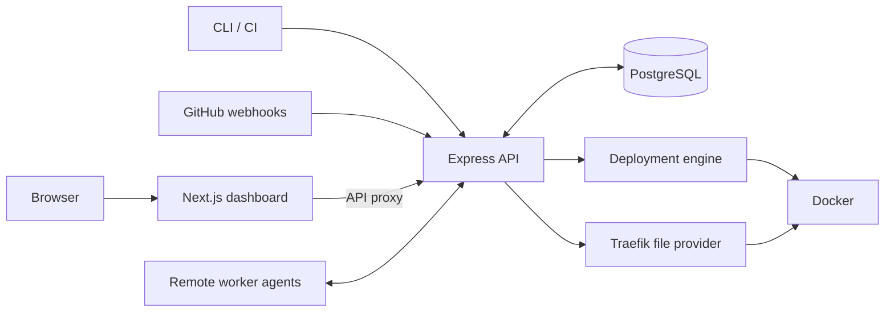

## Introduction — Why I started building Shipyard

I built Shipyard to understand the parts of a deployment platform that are usually hidden behind a button. The project takes a GitHub repository, detects how it should be built, creates a Docker image, starts an isolated application, checks that it is responding, and serves it through a stable address.

The goal is not to present Shipyard as a replacement for a large hosted platform. It is a self-hosted TypeScript codebase that makes the path from source code to running application inspectable. The current repository describes roughly 24,600 lines of TypeScript, a 27-model PostgreSQL schema, and test suites that exercise both isolated logic and real Docker, Traefik, and PostgreSQL services. That scope makes it a useful engineering case study: deployment is not one API call, but a sequence of state changes that must remain safe when something goes wrong.

## 1. Understanding the problem

For a developer, the desired workflow is simple: connect a repository, choose a branch, and receive an application URL. The implementation underneath has to answer harder questions:

- Which part of the repository is deployable?
- Should Shipyard use the repository's Dockerfile or generate one?
- Which port does the application listen on?
- Is a started container actually ready to receive requests?
- How can a new version replace an old version without making the project address disappear?
- What should remain available for diagnosis if a build or startup fails?

Shipyard's stated workflow is GitHub repository → detection → Docker build → health check → stable route. The deployment engine makes that workflow explicit with the statuses `QUEUED`, `CLONING`, `DETECTING`, `BUILDING`, `STARTING`, `HEALTH_CHECKING`, `HEALTHY`, `ROUTING`, and `RUNNING`. A failed deployment records the stage at which it failed and keeps the relevant runtime container stopped rather than immediately deleting the evidence.

That distinction between the goal and the implementation matters. Shipyard supports more than the first Node.js-only milestone now: the detector handles common Node.js, Python, PHP, Go, Java, Rust, and static web projects, while the platform also has workers, environments, services, and governance features. At the same time, some operational capabilities remain deliberately scoped. For example, the health check is a startup readiness decision, not continuous application monitoring.

## 2. Architecture and technology choices

Shipyard is an npm workspaces monorepo. The dashboard is a Next.js App Router application. An Express API owns validation, authorization, deployment orchestration, and persistence. PostgreSQL, accessed through Prisma, stores projects, deployments, deployment events, queue jobs, and operational state. Docker runs application containers, while Traefik receives requests and forwards them to the currently active deployment.

The repository's architecture can be reduced to this verified flow:



The API is the control plane. It decides which deployment may run, persists the state transition, and selects a worker when remote workers are enabled. The deployment engine is intentionally narrower: it knows how to clone, detect, build, start, check, and route one deployment, but it does not decide project-level policies. `DeploymentService` adds those policies, including one active deployment operation per project environment and retirement of the previous deployment only after the replacement is running.

PostgreSQL is more than a record of completed deployments. It is also the durable queue. Workers claim jobs with `FOR UPDATE SKIP LOCKED`, renew 60-second leases, and allow lost work to be recovered. That choice keeps scheduling state close to the deployment state that explains it. It also avoids making an in-memory queue the only place where a deployment request exists.

## 3. From source code to a running application

The core engine follows a deliberately visible pipeline.

### Clone and detect

For a source deployment, Shipyard prepares a disposable workspace and clones the selected repository and branch. It records the resulting commit SHA. The detector then looks for a repository-provided Dockerfile and supported project configuration. If no suitable Dockerfile exists, it can generate one for a detected language and framework. Repository layout is also considered, including deployable applications inside common workspace or monorepo directories.

This phase is read-oriented: the repository is inspected to produce a build plan, and generated files are written only into the disposable clone. The source is not treated as trusted executable setup code on the host.

### Build

The build plan supplies Docker with a context, Dockerfile, image name, and build environment. `.dockerignore` is respected and `.git` is excluded from the build context. When a package installation fails, the API keeps the relevant tail of build output and attempts to explain the package manager's actual failure instead of exposing only a generic non-zero exit code.

After the image is built and published to the configured image registry abstraction, the clone can be cleaned up because the source needed at runtime is now in the image.

### Start

The engine creates and starts the container with a deterministic deployment name. Shipyard sets the application's `PORT` and publishes the health-check port on loopback. A routed web service is attached to the Docker network shared with Traefik. Private services can instead be reached by service name on a project network, and worker services are not placed behind the public route.

The same mechanics support replicas: the first replica is started and checked before subsequent replicas are started. A bad version therefore fails before the remaining replicas are brought up or the deployment receives traffic.

### Health check and route

Once the container starts, Shipyard does not assume that Docker startup means application readiness. It polls the application through its published loopback port. With the default health path, any HTTP response below 500 is sufficient; a configured path is stricter and requires a 2xx or 3xx response. If the process exits, the checker fails early and includes the exit code or out-of-memory condition when available.

Only after the health check passes does the engine ask the router to activate the deployment. Once the router confirms that visitors reach the new deployment, the status becomes `RUNNING`.

## 4. Docker and application isolation

Docker provides the boundary between Shipyard's control process and a deployed application. Shipyard builds an image, starts a container with runtime variables, and records the container identifiers and ports as deployment state. It can also apply resource limits, restart policies, volumes, private networks, and multi-service configuration.

The isolation is practical rather than a claim of complete security. The repository includes controls such as encrypted environment variables, scoped access, and restrictions around routing and secrets, but Docker containers and a self-hosted host still need to be operated responsibly. A deployment platform should not describe a container boundary as an unconditional security guarantee.

One useful detail is that visitor traffic and health traffic have different paths. The health checker uses a loopback-published port so Shipyard can test the process directly. Routed traffic goes through Traefik over the shared `shipyard-edge` network. In the integration tests, the application port is published only on `127.0.0.1`, while Traefik reaches the container through its Docker network.

## 5. Routing and Traefik

With the public domain configured as `localhost`, a project named `shop` is served at `http://shop.localhost`. In production configuration, the same routing model can use HTTPS and custom domains. The project identity becomes the generated hostname, while the active deployment determines the container target behind that hostname.

Shipyard uses Traefik's file provider rather than giving Traefik the Docker socket. The router maintains one route per project and writes a complete dynamic configuration file. It writes a temporary file and atomically renames it into place, so Traefik does not observe a half-written route table. The file contains a host rule, a service pointing at the container name and port, and a response header containing the deployment ID.

That response header is important for cutover. A successful file write does not prove that Traefik has reloaded the configuration. `TraefikRouter.activate()` probes the project hostname until the response identifies the new deployment. Only then can the old container be retired.

The relevant part of the routing contract is small:

```ts
await this.deps.router.activate({
  name: routeName,
  aliases: job.domains,
  deploymentId: job.id,
  containerName: state.containerName,
  containerPort: state.containerPort!,
  hostPorts: state.hostPorts,
  ...replicaRouting(state.containerName, replicas, healthCheck),
});

state.deploymentUrl = url;
await moveTo(DeploymentStatus.RUNNING);
```

This is not the whole routing implementation, but it shows the boundary: the deployment engine supplies an already-healthy target, and the router owns the observable switch.

## 6. Health checks and zero-downtime redeployment

The important ordering is:

```text
new container → health check → HEALTHY → Traefik cutover → RUNNING → retire old container
```

The old deployment remains the active route while the new one is cloning, building, starting, and being checked. If the new container crashes, returns 5xx responses, or never answers within its timeout, the new deployment becomes `FAILED` and the route is not changed.

The distinction between `HEALTHY` and `RUNNING` is intentional. `HEALTHY` means the process passed its startup check. `RUNNING` means the project address has also been confirmed to reach that deployment. This makes routing failure a separate, diagnosable failure rather than an implicit success after a container starts.

During cutover, the router writes the new table, waits for Traefik to serve the new deployment ID, and restores the previous route if confirmation times out. The deployment service then retires the old deployment only after the replacement is running. This is the mechanism behind Shipyard's zero-downtime redeployment behavior; it is not based on a fixed sleep or on the assumption that a Docker process is immediately ready.

Rollback follows the same safety path. The rollback endpoint selects an earlier deployment that ran successfully and still has its container. That deployment is health-checked, routed, and confirmed before the current deployment is retired. A restart of the live container is different: it reuses the same container and is not described as zero-downtime replacement.

Passing a startup health check is still not proof that the application is reliable forever. Shipyard's own documentation describes continuous monitoring as future work. The check answers a narrower question: may this version take traffic now?

## 7. Engineering challenges and trade-offs

Several implementation choices expose the difficult parts of deployment orchestration.

**Queue recovery.** A worker can disappear after claiming a job. PostgreSQL row locking, renewable leases, worker capacity checks, and recovery rules make that case explicit. The trade-off is more state and reconciliation logic than an in-memory queue, but the platform can explain and recover work after a process restart.

**Routing state.** A route file is simple to inspect and keeps Traefik away from the Docker socket, but it creates a synchronization problem. Shipyard therefore treats the database as the source of truth, rewrites the complete route table atomically, serializes route changes, and rebuilds routes from running deployments at startup.

**Health semantics.** Requiring a special `/health` endpoint would be precise but would make first deployments harder for small applications. The default rule accepts any response below 500 because it proves that a server is listening; configured health paths use stricter success semantics. This is a useful compromise, but it cannot validate every dependency or user journey.

**Failure evidence.** Failed containers are stopped but retained long enough for runtime logs to be inspected. Deployment history records status transitions, actors, and failure messages. That adds cleanup responsibility, but a platform that deletes every failed container immediately makes debugging needlessly difficult.

**Broad stack detection.** Supporting several languages and package managers improves the first-run experience, while generated Dockerfiles add maintenance and edge cases. Shipyard reduces one risk by matching package managers to lockfiles and refusing to silently relax frozen installs. The remaining trade-off is that detection can never know every repository convention.

## 8. Testing and verification

The repository separates fast unit tests from integration tests. The README currently reports 639 unit tests and 156 integration tests, while the API test tree includes focused suites for detection, Docker behavior, health checks, scheduling, deployment state, and Traefik routing.

The integration tests are especially relevant to the platform's claims. The deployment suite uses a real Docker daemon, builds a real application image, starts a real container, performs a real HTTP health check, verifies logs, and exercises restart and stop behavior. Its failure cases include a crashing application and a generated Dockerfile path.

The routing suite starts Traefik, deploys through the real Docker network, and keeps issuing requests while a replacement is cut over. It verifies the stable hostname, the deployment-identifying response header, and the behavior when a new version fails. These tests are stronger evidence for zero-downtime routing than a unit test that only inspects a generated YAML object.

The repository also runs the unit and integration suites through Vitest and checks them in GitHub Actions. This article is based on the source, documentation, and test definitions available in the public repository; I have not treated the README's test totals as a benchmark or as evidence of production traffic.

## 9. Current limitations

Shipyard is an ambitious self-hosted project, not a promise that every deployment environment is solved. The current implementation still has meaningful boundaries:

- Startup health checks do not replace continuous monitoring of a running application.
- Docker, Traefik, PostgreSQL, credentials, DNS, and host capacity still need to be operated correctly by the person running Shipyard.
- Generated build plans support many common stacks, but unusual repositories may still need an explicit Dockerfile or service configuration.
- The self-hosted control plane introduces upgrade, backup, and restore responsibilities.
- A restart of the live container is not equivalent to a zero-downtime replacement deployment.

These limitations are part of the engineering story. A deployment is only as dependable as the control plane, runtime, routing layer, and recovery paths around it.

## 10. What I learned

The most useful lesson is that deployment orchestration is a coordination problem. Starting a container is only one transition in a larger state machine. The platform must preserve a meaningful record of what happened, decide when traffic may move, and retain enough evidence to explain a failure.

I also learned why routing and health checks must be designed together. A health check against a published port says that a process responds directly. It does not say that Traefik has loaded the route or that visitors reach the new version. Shipyard makes both conditions explicit.

Finally, infrastructure code needs tests that cross process boundaries. Unit tests can prove status transitions and configuration generation. Real Docker and Traefik tests are needed to discover behavior around startup timing, network reachability, proxy reloads, and replacement traffic. That combination provides a more honest signal than either suite alone.

## 11. What's next

The repository already contains a broad platform surface, and future work should remain focused rather than simply adding more integrations. Practical next steps include richer deployment diagnostics, stronger continuous runtime monitoring, more operational visibility, and continued hardening of self-hosted upgrades and recovery.

Those are proposals, not features to count as complete today. The useful design constraint is to preserve the existing evidence trail: every new capability should make deployment state, routing state, and failure causes easier to observe.

## Conclusion

Building Shipyard changed how I think about the word “deploy.” The visible action may be a button or a webhook, but the engineering work is the sequence beneath it: inspect source, build safely, start an isolated process, establish readiness, switch traffic deliberately, and recover without hiding what failed.

The [Shipyard source code on GitHub](https://github.com/milansingla/shipyard) is the best place to explore the implementation and tests. You can also find Shipyard alongside my other work on [The Little Engineer](/) and browse my [CV](/cv).
